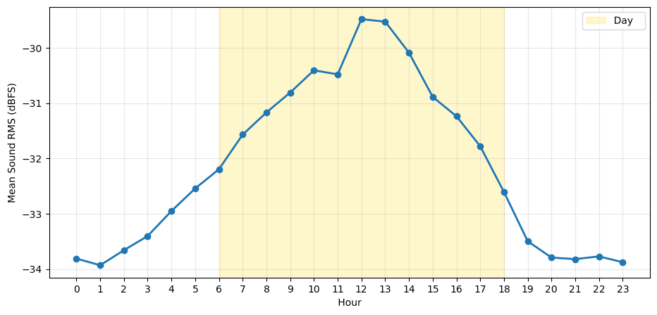
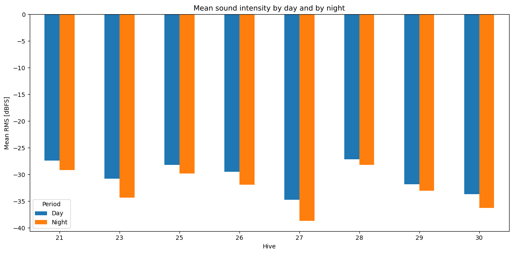
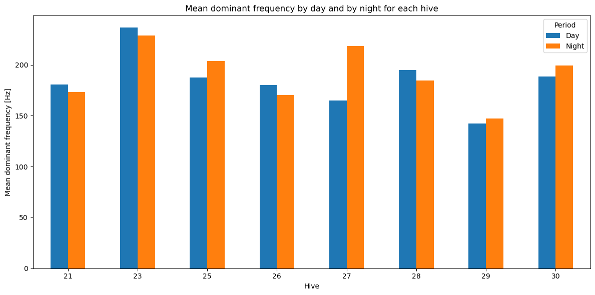
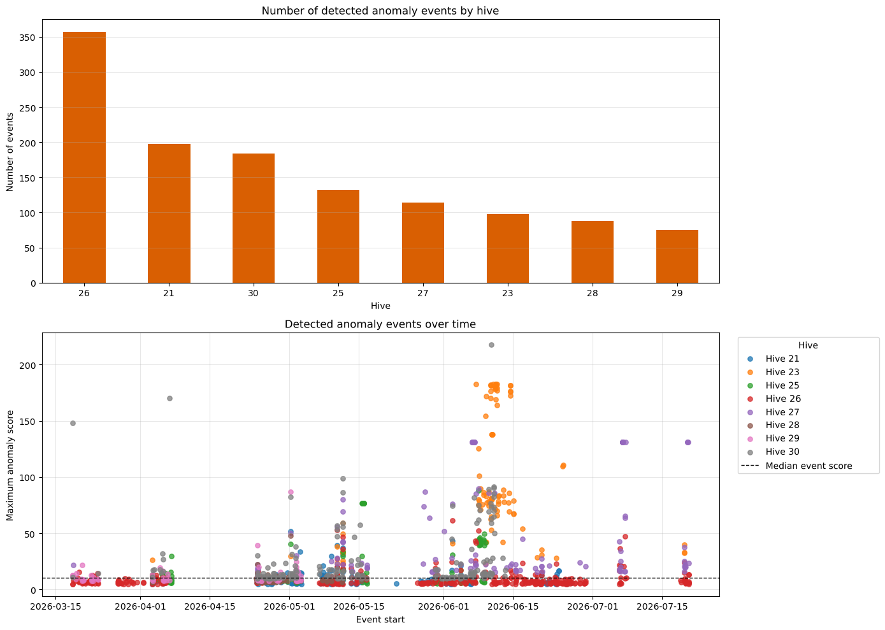
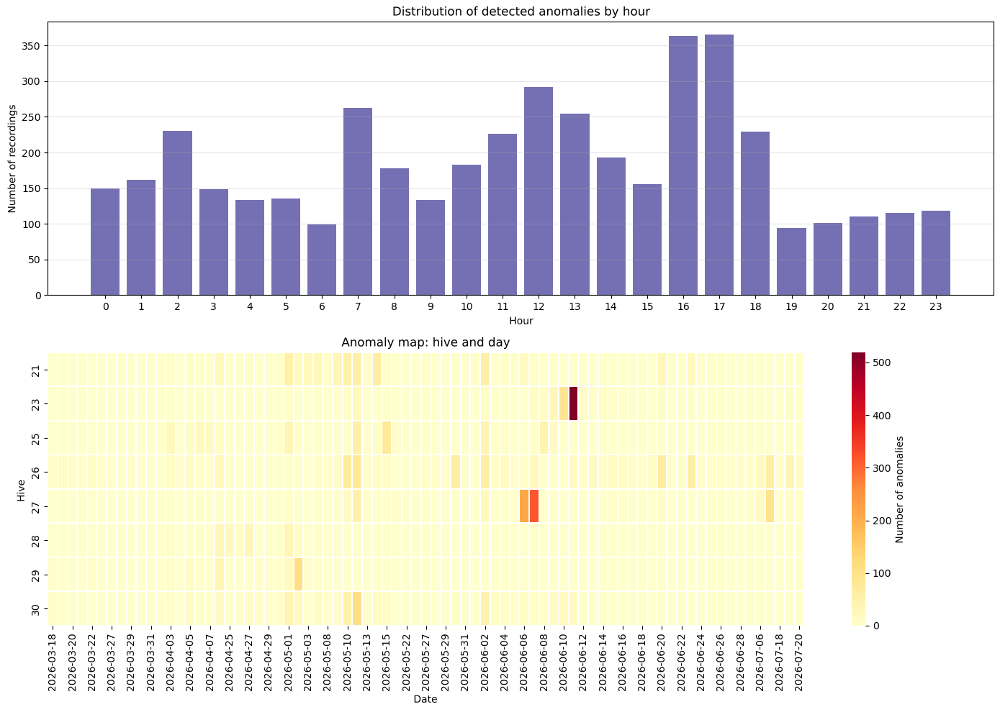
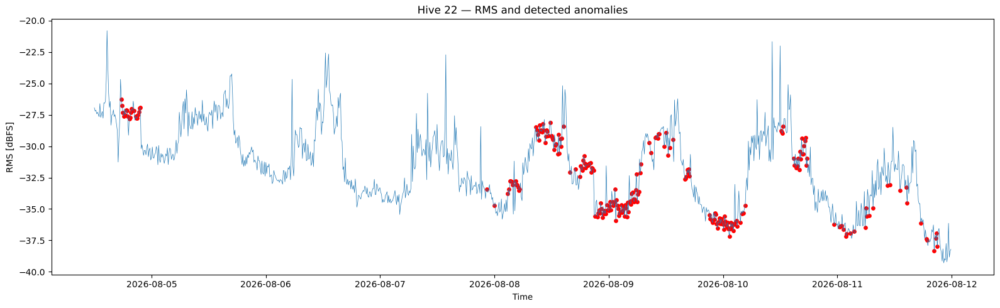
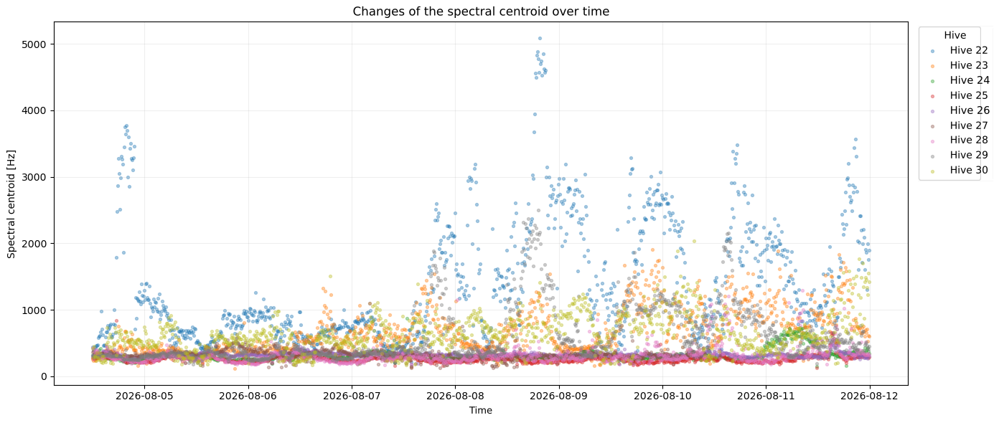

# Acoustic and environmental analysis of beehive sensor data

Notebooks from my internship at Symbiotica (July–August 2026), part of my MSc in Bioinformatics. The goal was to turn raw audio from sensors placed inside beehives into numerical features, and to use them to describe the daily rhythm of a colony and to detect unusual events.

The notebooks (comments, markdown and plot labels) are written in English, the code is plain Python.

## Selected results

**Daily rhythm.** Mean loudness (RMS in dBFS) by hour of the day, for the historical dataset. The shaded area marks daytime (06:00–18:00). Colonies are loudest around midday and quietest at night.

  

**Day vs night per hive.** Mean RMS (left) is higher by day in every hive. Mean dominant frequency (right) does not show a consistent direction between hives.

<table>
  <tr>
    <td></td>
    <td></td>
  </tr>
</table>

**Anomaly events.** Number of detected anomaly events per hive (top) and the maximum anomaly score of each event over time (bottom). Several hives show events in the same periods.

  

**When anomalies occur.** Distribution of detected anomalies by hour of the day (top) and anomaly counts per hive and day (bottom). Most anomalies are concentrated on a few days.

  

**New sensors.** Hive 22 over about one week of recordings: RMS with detected anomalies in red (first figure), and the spectral centroid of all nine hives over the same week (second figure). Hive 22 clearly differs from the others, with a much higher spectral centroid.

  

  

## Data

Two sensor datasets were used:

- **Historical data:** continuous recordings from 8 hives, together with environmental data (temperature, humidity and others).
- **New sensor configuration:** short 15-second recordings every 10 minutes from 9 hives. Only audio was available for this set.

The data belongs to the company and is **not included** in this repository. Sensor identifiers and apiary names in the notebooks are replaced with neutral labels (`sensor_21`, `Apiary A` and so on), and file paths point to a local `data/` folder. The notebooks are meant to be read, they will not run without the original files.

## What is in the notebooks

**`notebooks/audio_analysis.ipynb`** – historical data

- sorting and checking audio files (sampling rate, integrity of every file)
- choosing which hives and recordings are good enough to analyse, by comparing audio and environmental date ranges and filtering out very quiet, very short or empty recordings
- feature extraction from audio: RMS (converted to dBFS), spectral centroid, bandwidth and rolloff, zero-crossing rate, energy in frequency bands, dominant frequency (f0) and MFCC
- checking my own feature extraction against a ready-made file from the company (day and night RMS matched closely)
- daily rhythm of the colony and the difference between day and night
- anomaly detection and grouping of anomalies into events (see below)
- KMeans clustering of recordings on MFCC features (the code runs, but the clusters did not give a clear biological interpretation)

**`notebooks/new_sensors.ipynb`** – new sensors

- the same approach applied to the new, independent dataset
- saving and reloading computed features, so the slow audio scan does not repeat on every run
- anomaly detection based on RMS and spectral centroid
- a closer look at one hive that differs clearly from the others

## Anomaly detection

Two methods that complement each other:

1. **Hourly z-score:** each recording is compared with the typical value for the same hour of the day. Recordings with |z| ≥ 3 are marked as anomalies.
2. **MAD per hive:** a robust version that uses the median and the median absolute deviation separately for every hive, with a threshold set at the top 1% of scores.

Neighbouring anomalous recordings (gap shorter than 5 minutes) are merged into one event. Events caused by sensor saturation, where f0 sticks to the upper limit of the measurement range, are removed as artifacts.

## Main observations

- The hives show a clear daily rhythm. Loudness is highest around midday and lowest at night, which is what we would expect biologically.
- Several hives showed anomalies at almost the same time, in both datasets. Such synchronisation points to a shared external cause (for example weather) rather than a local event in one colony.
- In the new dataset one hive stood out with a much higher share of high-frequency energy and long anomalous episodes.
- Correlating acoustic features with environmental data did not give clear results in my first attempts, so I did not continue with it (the code is left commented out in the notebook).

## Repository contents

- `notebooks/` – the two analysis notebooks, with their outputs
- `images/` – the figures shown above, exported from the notebooks

## Tools

Python, Jupyter, pandas, NumPy, matplotlib, seaborn, librosa, soundfile, SciPy, scikit-learn, statsmodels, tqdm

## Author

Wiktoria Kowalska – [GitHub](https://github.com/RelVexai) · [LinkedIn](https://www.linkedin.com/in/wiktoria-kowalska-1984693b1/)
